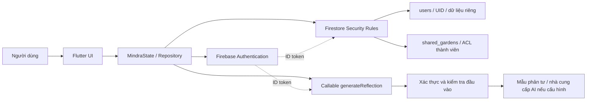

# Kiến trúc và luồng dữ liệu

Phạm vi: code tại workspace, không phải chứng nhận cấu hình Firebase production. `AGENTS.md` còn mô tả bản in-memory cũ; sơ đồ dưới đây dựa trên repository và state thực tế.

## Ranh giới tin cậy

1. Flutter và dữ liệu gửi từ client không đáng tin: kiểm tra giao diện chỉ giúp UX, không quyết định quyền.
2. Firebase Auth xác định danh tính. Đăng nhập không có nghĩa được đọc mọi dữ liệu.
3. Rules quyết định quyền theo UID trong đường dẫn và ACL đã lưu, kiểm tra dữ liệu sau ghi trên cả create/update.
4. Callable có kiểm tra riêng. Admin SDK ở server không chịu Firestore Rules. Endpoint hiện không nhận ID nhật ký/owner và không đọc nhật ký từ database; chỉ xử lý nội dung caller gửi.
5. Emulator chỉ là môi trường thực nghiệm. Không dùng token, tài khoản hoặc nhật ký thật. Nhánh Emulator không gọi nhà cung cấp AI bên ngoài.

## Collection và truy vấn thực tế

| Đường dẫn | Dữ liệu / truy vấn | Quyền |
|---|---|---|
| `users/{uid}` | Chưa có client writer trong app | Owner đọc; ghi bằng client bị đóng |
| `users/{uid}/journal_entries/{id}` | Cảm xúc, mức độ, tình huống, suy nghĩ, phản ứng, kết quả bài tập; `orderBy(timestamp, descending: true)` | Owner CRUD, schema kiểm tra khi ghi |
| `users/{uid}/garden_moments/{id}` | Tham chiếu entry, tháng, luống, ô, thời điểm, biến thể; `orderBy(plantedAt, descending: true)` | Owner CRUD; entry phải thuộc đường dẫn owner và tồn tại |
| `users/{uid}/micro_goals/{id}` | Schema dự phòng của model; state hiện giữ mục tiêu trong bộ nhớ | Owner CRUD theo schema, chưa tuyên bố đồng bộ mục tiêu |
| `shared_gardens/{id}` | Tối đa 2 thành viên, tên hiển thị, mã mời, bộ đếm vị trí; query `members array-contains uid`, `limit(1)` | Thành viên đọc; các chuyển trạng thái được kiểm tra riêng |
| `shared_gardens/{id}/moments/{id}` | Nội dung được chủ động chia sẻ, tác giả, lượt chăm sóc; `orderBy(plantedAt)` | Thành viên đọc; tạo theo giao dịch phân bổ; không sửa tác giả/nội dung |
| `.../moments/{id}/care/{uid}` | Biên nhận tưới nước/nắng của thành viên | Chỉ người đó đọc/ghi theo giao dịch hợp lệ |
| `shared_garden_invites/{code}` | Chỉ `gardenId` | Authenticated GET khi biết mã; cấm LIST |
| Collection riêng tư cấp gốc cũ | Không còn dùng làm fallback khi thiếu UID | Đóng truy cập client, không xóa dữ liệu cũ |

## Tính tương thích

- Giữ cấu trúc dữ liệu và truy vấn; không di chuyển nhật ký hiện có.
- Ngày đang là ISO string: rules kiểm tra định dạng/độ dài và tính bất biến ở trường tạo, không coi đó là thời gian server đáng tin.
- Schema chặt hơn có thể từ chối cập nhật tài liệu cũ sai cấu trúc. Cần kiểm kê/migration riêng trước production; không mở rộng rules chỉ để bỏ qua lỗi.
- Thay đổi tài khoản tăng revision phiên, xóa cache riêng và dựng lại Navigator để màn chi tiết cũ không còn trên stack.
- Phản hồi bất đồng bộ phải khớp UID và revision; chỉ kiểm tra UID không đủ cho trường hợp A → B → A.
